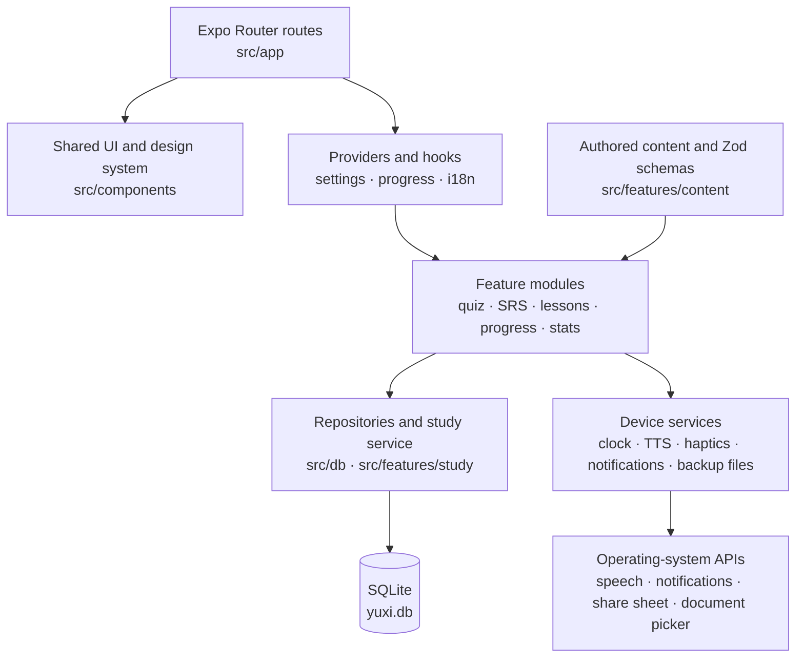

<p align="center">
  
</p>

<h1 align="center">Yuxi: Learn Japanese</h1>

<p align="center">
  A private, offline-first Japanese learning app for Urdu speakers.<br />
  No account. No backend. No ads. No analytics. No application-level network requests.
</p>

<p align="center">
  
  
  
  
  
  
</p>

> **Project status: pre-release, not production-ready.** Version 1.0.0 is the current
> development version. The core learning flows and automated quality gates are in place,
> but human content review, device-level QA, the UI redesign and release engineering are
> not finished. There is no public app-store listing, signed production build, EAS project
> or continuous-integration pipeline. Do not treat this repository as a shipped product.

## Table of contents

**Product**

- [Project status](#project-status)
- [Overview](#overview)
- [At a glance](#at-a-glance)
- [Product principles](#product-principles)
- [Features](#features)
- [Screens](#screens)

**Engineering**

- [Architecture](#architecture)
- [Technology](#technology)
- [Repository layout](#repository-layout)
- [Getting started](#getting-started)
- [Configuration](#configuration)
- [Quality gates](#quality-gates)

**Systems and operations**

- [Data and storage](#data-and-storage)
- [Content pipeline](#content-pipeline)
- [Learning engine](#learning-engine)
- [Privacy, security and compliance](#privacy-security-and-compliance)
- [Accessibility and internationalization](#accessibility-and-internationalization)
- [Build and release](#build-and-release)
- [Release readiness](#release-readiness)
- [Known limitations](#known-limitations)
- [Roadmap](#roadmap)

**Project**

- [Contributing](#contributing)
- [Support and security](#support-and-security)
- [Documentation](#documentation)
- [License](#license)
- [Acknowledgements](#acknowledgements)

## Project status

Yuxi is an independent, pre-release project. The repository is public at
[`HAMZAPOWERPLAYER/YUXI`](https://github.com/HAMZAPOWERPLAYER/YUXI), and `main` is the
development branch.

| Area                     | Status               | Notes                                                                                                                   |
| ------------------------ | -------------------- | ----------------------------------------------------------------------------------------------------------------------- |
| Kana and course learning | Implemented          | Kana charts, practice, SRS, lessons, exercises, progress and statistics are implemented and covered by automated tests. |
| Part 2 course content    | Authored, not signed | 20 units are authored; every item still requires Japanese, Urdu and content-safety review.                              |
| Automated verification   | Passing locally      | 482 tests across 41 suites; content validation, schema freshness and the offline privacy gate pass.                     |
| UI redesign              | In progress          | Milestones D-M0 to D-M2 are complete. Screen migration continues through D-M10; legacy re-export shims remain.          |
| Device QA                | Not started          | No Android emulator, iOS simulator or physical device was available for release-build visual QA.                        |
| Release engineering      | Not configured       | No EAS project, signing credentials, store metadata or CI workflow exists.                                              |
| Licensing                | Apache-2.0           | Application source is Apache-2.0. Bundled fonts remain under SIL OFL 1.1.                                               |

## Overview

Yuxi teaches Japanese **Hiragana** and **Katakana** to Urdu speakers, then extends into
beginner vocabulary, sentences and short lessons. The interface is fully bilingual
(Urdu and English), with Urdu as the default. Japanese learning content stays
left-to-right inside the Urdu interface.

The product is designed around a simple constraint: **the device is the product
boundary**. There is no account service, no content server, no push server and no
telemetry. Settings, progress, review history and daily statistics live in a private
SQLite database. A user-initiated JSON backup can move progress between installations.

The visual system is a calm dark theme with a crimson accent (`#E11D2E`), bundled
Nunito, Noto Sans JP and Noto Nastaliq Urdu fonts, and a centralized mascot asset map.
The current redesign moves screens onto shared Neon Night tokens and primitives in
staged milestones rather than one risky rewrite.

## At a glance

| Item                | Value                                                                                                          |
| ------------------- | -------------------------------------------------------------------------------------------------------------- |
| Application         | Yuxi: Learn Japanese (`com.hamzapowerplayer.yuxi`, provisional)                                                |
| Version             | `1.0.0` (pre-release; not in app stores)                                                                       |
| Platforms           | Android and iOS; browser rendering is a development preview                                                    |
| Interface languages | Urdu (default) and English                                                                                     |
| Kana content        | 208 Hiragana and Katakana records                                                                              |
| Course content      | 20 units, 80 lessons, 420 vocabulary items/phrases, 140 sentences, 560 exercise items                          |
| Persistence         | On-device SQLite (`yuxi.db`) with schema version 2; JSON backup format version 2 with version-1 import support |
| Runtime network     | None initiated by application code; the Android manifest carries an Expo-added `INTERNET` permission           |
| Stack               | Expo SDK 58.0.19, React Native 0.88.0, React 19.3.0, TypeScript 6.0.3                                          |
| Automated gate      | 482 tests / 41 suites; 97.97% statements, 92.26% branches, 99.78% functions, 99.36% lines                      |
| License             | Apache License 2.0; bundled fonts under SIL OFL 1.1                                                            |

## Product principles

1. **Local-first by construction.** Learning state is written to the device, not to a
   remote account. Export, import and reset are explicit user actions.
2. **Urdu-first, not Urdu-as-an-afterthought.** Urdu is the default language, typography
   uses Noto Nastaliq Urdu, and layout direction is handled explicitly instead of relying
   on native mirroring.
3. **Authored content over runtime inference.** Furigana is stored as data, exercise
   templates are authored, and course files are validated before they can ship.
4. **Deterministic core logic.** Time and randomness are injectable, so scheduling,
   selection, lesson runs and tests are reproducible.
5. **Accessibility is a constraint, not a polish task.** Labels, roles, state
   announcements, 48 pt targets, large-text behavior, reduced motion and non-color
   mastery cues are part of the component contract.
6. **Release honesty.** The repository documents what is implemented, what is verified
   and what is still blocked instead of presenting pre-release work as production-ready.

## Features

| Area             | What is included                                                                                                  |
| ---------------- | ----------------------------------------------------------------------------------------------------------------- |
| Learning content | 208 kana records plus 20 Part 2 units: 80 lessons, 420 words/phrases and 140 sentences                            |
| Charts           | Grouped kana charts with romaji toggle, mastery colors and per-kana detail                                        |
| Audio            | Japanese pronunciation through the device text-to-speech engine, including a missing-voice recovery flow          |
| Practice         | Kana to romaji, romaji to kana, listening and mixed mode                                                          |
| Question engine  | Adaptive selection weighted by overdue cards, weak cards and new cards; four unique options per question          |
| Scheduling       | SM-2 inspired spaced repetition with lapses, ease adjustment and a 180-day interval cap                           |
| Lessons          | Unit browser, sequential unlocking, seeded player, completion summary and safe replay                             |
| Exercises        | Seeded choice, sentence-builder and particle-cloze generators with an authored-furigana renderer                  |
| Motivation       | XP, levels, daily goal, current/best streak and a session-complete bonus                                          |
| Statistics       | 7/30-day accuracy, 14-day activity chart, kana mastery heatmap and lifetime totals                                |
| Data             | SQLite persistence, generalized SRS for kana/vocabulary/sentences, JSON backup v2 with v1 import and full reset   |
| Reminders        | One local daily reminder with three rotating messages; no push server                                             |
| Settings         | Language, text size, daily goal, haptics, reminder, backup and reset                                              |
| Information      | About, privacy policy, generated open-source license list and a not-found screen                                  |
| Accessibility    | Screen-reader labels, 48 pt targets, reduced-motion handling, large-text support and explicit RTL layout          |
| Content pipeline | Zod course schema, original-content validator, lazy unit registry and JSON Schema artifacts                       |
| Privacy          | No account, analytics, advertising or application-level network calls; an automated network-primitive gate exists |

## Screens

| Screen                   | Purpose                                                                                        |
| ------------------------ | ---------------------------------------------------------------------------------------------- |
| Onboarding               | First-run setup and language/preferences introduction                                          |
| Home                     | Daily-goal progress, streak status, quick actions and review entry points                      |
| Learn                    | Hiragana and Katakana charts plus the course browser                                           |
| Practice                 | Practice setup, timed session and session summary                                              |
| Stats                    | Accuracy, activity, mastery heatmap and lifetime totals                                        |
| Settings                 | Language, text size, daily goal, haptics, reminder, backup/import, reset, privacy and licenses |
| Course, unit and lesson  | Unit listing, lesson locking, seeded lesson player and completion summary                      |
| Kana detail              | Per-kana glyph, romaji, Urdu hint, confusables and pronunciation                               |
| About, privacy, licenses | Product information, in-app privacy policy and generated dependency/font license list          |
| Not found                | Fallback route for unmatched links                                                             |
| Development UI gallery   | Component-state and RTL inspection route; redirects to home in production and is not linked    |

Screens are not presented as final visual QA evidence. The current verification boundary
is documented in [`docs/DESIGN_QA.md`](docs/DESIGN_QA.md): no emulator, simulator or
physical device was available for the redesign milestones completed so far.

## Architecture



The codebase separates five concerns:

- **Presentation.** Expo Router route files in `src/app/` compose screens from shared
  primitives. Settings and progress read models are provided through React context.
- **Domain logic.** Pure TypeScript modules implement question selection, the quiz
  engine, SM-2 scheduling, lesson availability, exercise generation, XP/streaks and
  statistics. These modules do not depend on React Native UI.
- **Persistence.** `src/db/` owns the SQLite client, versioned migrations and
  repositories. `src/features/study/` writes answers, review history and daily totals in
  one transactional path shared by practice and lessons.
- **Platform services.** Clock, TTS, haptics, local notifications and backup file
  handling sit behind small service modules so screens do not call native APIs directly.
- **Content.** Authored JSON is validated by Zod, loaded lazily through an explicit unit
  registry and cached after first parse. JSON Schema artifacts are generated for editors.

There is no backend tier. Backup export writes to the app cache and opens the system
share sheet; import reads only the file selected through the system document picker.
Local notifications are scheduled by the operating system. Pronunciation uses the
device's installed text-to-speech engine.

## Technology

| Layer           | Technology                                                                                   |
| --------------- | -------------------------------------------------------------------------------------------- |
| Runtime         | Expo SDK **58.0.19**, React Native **0.88.0**, React **19.3.0**                              |
| Navigation      | Expo Router **58.0.26**; typed routes are disabled                                           |
| Language        | TypeScript **6.0.3**, strict mode with `noUncheckedIndexedAccess`                            |
| Persistence     | Expo SQLite **58.0.14**; SQLCipher disabled, database protected by the OS app sandbox        |
| Validation      | Zod **4.6.7** for backup and course-content schemas                                          |
| Notifications   | Expo Notifications **58.1.6**; local-only, no remote push configuration                      |
| Audio           | Expo Speech **58.0.3**; installed device voices, no bundled recordings                       |
| Styling and UI  | React Native StyleSheet, Reanimated, Gesture Handler, Safe Area Context, Screens and SVG     |
| Fonts           | Nunito 600/800, Noto Sans JP 400/500/700 and Noto Nastaliq Urdu 400/700, all bundled locally |
| Testing         | Jest **30.5.2**, jest-expo **58.0.12**, Testing Library **14.1.0**, sql.js **1.15.2**        |
| Tooling         | tsx **4.23.15**, ESLint 9 with `eslint-config-expo`, Prettier 3                              |
| Content schemas | Zod source of truth plus committed JSON Schema artifacts in `docs/content-schema/`           |
| Package manager | npm with lockfile version 3                                                                  |

The full dependency list is in [`package.json`](package.json); generated license
metadata is in [`src/generated/licenses.json`](src/generated/licenses.json).

## Repository layout

```text
src/
  app/                  Expo Router routes (screens and layouts)
  components/           Shared UI primitives and legacy re-export shims
    ui/                 Neon Night component baseline
  config/               App version and contact constants
  db/                   SQLite client, migrations and repositories
  features/
    backup/             Backup schema, build/apply service and file helpers
    content/            Course schema, validator, lazy registry and unit JSON
    exercises/          Furigana renderer plus pure Part 2 exercise generators
    kana/               Kana data, selectors and mastery model
    lessons/            Course read model, lesson run state, service and player components
    practice/           Practice setup components
    progress/           XP, levels, goals and streaks
    quiz/               Question selection, session engine and quiz UI
    reminders/          Reminder copy and scheduling rules
    settings/           Settings model, time picker and data actions
    srs/                SM-2 inspired scheduler
    stats/              Statistics aggregation
    study/              Transactional answer/session persistence
  generated/            Generated license metadata
  hooks/                Shared hooks (including reduced motion)
  i18n/                 Urdu/English resources, provider and helpers
  navigation/           Root stack, tab bar and app bootstrap
  providers/            Settings and progress read models
  services/             Clock, notifications, TTS, haptics and backup files
  theme/                Tokens, typography, fonts, theme provider and mascot map
  types/                Shared domain types
  utils/                Date, seeded random and local logging helpers
__tests__/              Unit and integration tests
assets/                 Icons, splash art, notification icon and final mascot WebP artwork
design-source/          Design sources and archived placeholder art (not bundled)
docs/                   Architecture, design, privacy, license and content-review docs
scripts/                License generation, content validation and offline privacy gate
```

The Expo SDK 58 template places routes in `src/app/`; the project keeps non-route code
outside that directory. `android/` and `ios/` are generated and are not committed.

## Getting started

### Requirements

- **Node.js** 22.13+, 24.3+ or 26+ (the verification environment uses Node 26.8.1).
- **npm** 10 or newer.
- Android Studio with an emulator, Xcode on macOS for iOS, or a physical device.
- No environment variables or local secrets are required.

### Install and run

```bash
git clone https://github.com/HAMZAPOWERPLAYER/YUXI.git
cd YUXI
npm ci
npx expo start
```

From the Expo terminal, press `a` for Android, `i` for iOS (macOS only) or `w` for the
browser preview. You can also run `npx expo start --android` or
`npx expo start --ios` directly.

### Development builds

Expo Go is sufficient for most JavaScript-only development, but it has limitations:

- On Android, Expo Go does not include the native topic-subscription module used by
  `expo-notifications`, so Yuxi disables reminders there.
- The custom notification icon, notification channel and splash configuration are
  applied by a native build, not by Expo Go.
- Release-build visual QA, splash behavior and the reminder flow require a development
  or production build.

Use Continuous Native Generation through Expo rather than editing `android/` or `ios/`:

```bash
npx expo run:android
# macOS only
npx expo run:ios
```

### Web preview

The app can render in a browser for development, but web is not a supported release
target. Local reminders are reported as unsupported and Japanese TTS depends on the
browser's installed voices.

## Configuration

| File                | Purpose                                                                                                 |
| ------------------- | ------------------------------------------------------------------------------------------------------- |
| `app.json`          | Expo app identity, scheme, icons, splash, notification plugin, SQLite settings and blocked permissions  |
| `src/config/app.ts` | App version fallback from Expo config and the current support email                                     |
| `package.json`      | Scripts, dependencies, Jest configuration, coverage thresholds and the `Apache-2.0` license declaration |
| `tsconfig.json`     | Strict TypeScript configuration and the `@/*` path alias                                                |
| `eslint.config.js`  | ESLint flat configuration based on `eslint-config-expo`                                                 |
| `.prettierrc.json`  | Formatting rules used by `npm run format` and `npm run format:check`                                    |

The final bundle identifiers, support email, EAS/store ownership, signing credentials
and release process are still unconfirmed. They are tracked in
[`docs/DECISIONS.md`](docs/DECISIONS.md).

## Quality gates

Run the full local gate before declaring a change complete:

```bash
npm run check
npm run format:check
```

`npm run check` executes, in order:

1. `tsc --noEmit`
2. ESLint over the repository
3. Course-content validation (schema, references, sizes, safety and registry drift)
4. Generated JSON Schema freshness check
5. Jest tests in band
6. Offline network-primitive gate over `src/`

Coverage is a separate command:

```bash
npm run test:coverage
```

### Current verification baseline

Latest verified local run (29 October 2026):

| Gate                  | Result                                                            |
| --------------------- | ----------------------------------------------------------------- |
| Jest                  | **482 tests passing across 41 suites**                            |
| Statements            | **97.97%** (threshold 85%)                                        |
| Branches              | **92.26%** (threshold 80%)                                        |
| Functions             | **99.78%** (threshold 90%)                                        |
| Lines                 | **99.36%** (threshold 85%)                                        |
| Content validation    | Passed: 20 units, 80 lessons, 420 vocabulary items, 140 sentences |
| Schema freshness      | Passed                                                            |
| Offline network gate  | Passed                                                            |
| TypeScript and ESLint | Passed                                                            |
| Prettier              | Passed via `npm run format:check`                                 |

Coverage is collected from domain logic, migrations, repositories, services and selected
helpers. Full screen flows are not covered by automated UI tests; they are exercised by
TypeScript, lint, focused component tests and manual device QA.

### Continuous integration

No CI workflow is configured. All gates above run locally. A future CI pipeline should
run `npm ci`, `npm run check`, `npm run test:coverage` and `npm run format:check` on every
pull request.

### Manual QA

- [`docs/DESIGN_QA.md`](docs/DESIGN_QA.md) defines the screen, RTL, accessibility,
  reduced-motion and release-build checklist. D-M3 onward is still pending.
- [`docs/content-review.md`](docs/content-review.md) defines Japanese, Urdu and
  halal/family-friendly review requirements for all authored content.

## Data and storage

The database is `yuxi.db`, opened lazily through `src/db/client.ts`. Schema version 2
contains:

| Table             | Purpose                                                                   |
| ----------------- | ------------------------------------------------------------------------- |
| `kv_settings`     | Key/value application settings                                            |
| `srs_items`       | Canonical SM-2 scheduling state for kana, vocabulary and sentences        |
| `kana_progress`   | Legacy kana mirror kept for one release so a rollback still sees progress |
| `lesson_progress` | Per-lesson completion, timestamps and answer totals                       |
| `bookmarks`       | Saved vocabulary and sentence ids with their unit                         |
| `review_log`      | Append-only answer history; `kana_id` holds the generic item id           |
| `daily_stats`     | XP, active seconds, question counts and goal completion per local day     |
| `meta`            | Session-complete markers and the device-local reminder identifier         |

Migrations run inside transactions and are tracked with `PRAGMA user_version`. Profile
import replaces all user-owned rows atomically, so a failed import cannot leave a
half-restored profile. Vocabulary and sentence rows live only in `srs_items`; kana rows
are additionally mirrored into `kana_progress` for one release.

### Backup format

Backups are JSON with `format: "yuxi-backup"` and `version: 2`. Version 2 stores
`srsItems`, `lessonProgress`, `bookmarks`, `dailyStats`, `reviewLog` and `meta`. Version 1
files are still accepted and normalized in memory into the v2 shape.

The file is capped at 10 MB, validated with Zod and excludes the device-local
notification identifier. Both Urdu and English settings travel with the backup. Import
requires explicit confirmation because it replaces current progress. Backup files are
**not encrypted**; treat them as personal learning data and store them somewhere trusted.

### Data lifecycle

- Export writes a JSON file to the app cache and opens the system share sheet only when
  the user starts an export.
- Import uses the system document picker and grants access only to the selected file.
- **Settings → Reset all data** performs a double-confirmed deletion of settings,
  progress, review history, daily statistics and local metadata, and cancels scheduled
  reminders.
- Android app-data backup is disabled with `allowBackup: false`. iOS backup behavior is
  controlled by the operating system and the user's iCloud settings.

## Content pipeline

Part 2 course content lives in `src/features/content/data/`: a `course.json` index plus
one JSON file per unit. Zod schemas in `src/features/content/schema.ts` are the source of
truth, and `docs/content-schema/` contains generated JSON Schema artifacts for editors.
Units are loaded lazily through the explicit map in
`src/features/content/contentRegistry.ts`, parsed on first use and cached.

```bash
npm run validate:content     # schema + references + sizes + safety + registry drift
npm run content:schema       # regenerate the committed JSON Schemas
npm run content:schema:check # fail if the committed schemas are stale
```

The validator prints a per-unit table of lessons, words, sentences and items. It fails on
duplicate ids, missing meanings, invalid readings or romaji, token/furigana mismatches,
broken references, non-consecutive lesson orders, undersized units or lessons, forbidden
terms, missing review flags and registry drift. Exercise templates are checked for
unsupported types, missing or wrong-kind references, unused fields, malformed alternate
orders, and duplicate, absent or ambiguous cloze particles. Warnings mark explicitly
allowed halal/dietary request phrases.

### Review status

Every content file and item carries `needsHumanReview: true`. The content is structurally
complete and tested, but a Japanese teacher and a native Urdu speaker must review
readings, hints, confusable pairs, vocabulary, sentence naturalness and
halal/family-friendly examples before release. The validator is a structural guard rail,
not a substitute for those reviews. Authoring conventions are in
[`src/features/content/data/README.md`](src/features/content/data/README.md); the review
checklists are in [`docs/content-review.md`](docs/content-review.md).

### Exercises and furigana

`src/features/exercises/` turns authored lesson templates into concrete exercises:
meaning choice, reverse choice, sentence builder and particle cloze. Generators are pure
and seeded, so the same lesson and seed always produce the same option order. When a
lesson has no templates, the default set covers both directions for each word, a builder
for each sentence and a particle cloze when a common particle is present.

`FuriganaText` renders authored `segments` by stacking small readings above the base
glyphs; it never parses kanji at runtime. Japanese text stays left-to-right even when the
UI language is Urdu. If segments are missing or stale, the component falls back to plain
Japanese text.

### Lesson browser and player

The Learn tab links to `/course`. Units are ordered by `course.json`, and each unit screen
lists its lessons with completion, accuracy and lock state. The first lesson of an open
unit is available; later lessons open only after the previous lesson is complete. A unit
with `requiresUnitId` stays locked until that unit is fully complete, and `minAccuracy` is
checked against the answers stored for the required unit.

A lesson run is seeded from the current time, so option order varies between attempts but
stays reproducible in tests. Choice, sentence-builder and particle-cloze exercises use the
same grading rules as the generated exercise tests. Every answer is saved through the
shared SRS, review-log and daily-stats path. The first completion stores the lesson
result and awards the one-time session bonus; repeating a completed lesson records new
answers without awarding the bonus again. Leaving a lesson early saves the answers but
does not mark the lesson complete. Completed lessons remain reviewable.

The course list, unit screen and lesson screen read the same pure overview model, so an
unlock rule cannot disagree between screens. Direct navigation to a locked lesson shows a
locked state instead of starting a run.

## Learning engine

- **SM-2 scheduling.** One scheduler serves kana, vocabulary and sentences. A correct
  answer under 2.5 seconds scores quality 5, a normal correct answer scores 4, a correct
  answer over 8 seconds scores 3, a wrong answer scores 1, and a wrong answer over
  12 seconds scores 0. Lapses return after 10 minutes. Ease never drops below 1.3 and
  intervals never exceed 180 days.
- **Adaptive selection.** Due cards come first, weighted by how overdue they are; then
  weak cards (below 70% accuracy with at least 3 attempts); then new cards, at most 5 per
  session. Spare slots go to studied cards, and the last three kana are avoided when
  choosing the opening question.
- **XP and levels.** 10 XP for a correct answer, 2 XP for a wrong answer, and 20 XP for
  finishing a practice session or completing a lesson for the first time. A level
  requires 200 XP.
- **Time accounting.** Active seconds are capped at 120 seconds per answer tick and
  stored per local day. A day counts toward the streak when the daily goal is met or a
  session is completed.
- **Determinism.** All randomness flows through `src/utils/random.ts`; all time access
  flows through `src/services/clock.ts`. Tests inject both rather than relying on wall
  clock behavior.

## Privacy, security and compliance

### Privacy by design

- No account, sign-in, email profile or user-generated content.
- No analytics, advertising, telemetry, crash uploads or tracking SDKs.
- No remote fonts, images, course content or application data downloads.
- No application code that opens a network connection.
- Learning state stays in the app's private SQLite database.
- Export, import, reminder changes and data deletion happen only after an explicit user
  action.
- `npm run check:network` fails if the main network primitives appear in `src/`.

The in-app privacy policy lives in `src/app/privacy.tsx`; the source document is
[`docs/privacy.md`](docs/privacy.md).

### Security boundaries

- Data at rest is protected by the operating-system app sandbox. SQLCipher is disabled, so
  the database is not separately encrypted by the app.
- Backups are unencrypted JSON. Once a backup leaves the app, its protection depends on
  the destination the user chooses.
- Notifications are local and delivered by the operating system; no push token or push
  server is involved.
- TTS passes text to the operating system's speech engine. Some devices or third-party
  engines offer network-based voices; if a user selects one, that engine may process the
  text under its own privacy policy. Yuxi itself does not send audio or text to a server.
- Android blocks the advertising-ID permission and legacy broad storage permissions.
  The generated manifest still declares `INTERNET` because an Expo module adds it. No app
  code opens a connection, but removing the permission is still an open release task.
- The app does not request camera, microphone, contacts, location or calendar access.

### What is not claimed

Yuxi has not undergone a formal security audit, penetration test or legal/compliance
review. The repository describes privacy properties and engineering controls; it does not
claim regulatory certification, encryption at rest, or a guaranteed absence of every
possible network path in third-party native code.

## Accessibility and internationalization

- Surfaces use logical `Row`/`Stack` primitives rather than hand-written left/right
  styles. The app reads language direction explicitly and does **not** call
  `I18nManager.forceRTL`, so switching language does not require a restart.
- The `expo-localization` config plugin sets `supportsRTL: false` so native RTL cannot
  double-mirror the app's own direction handling.
- Japanese sequences (kana charts, sentence builders and quiz prompts) force an LTR row
  and text direction inside the Urdu UI. Directional icons such as the back chevron are
  chosen from the current direction.
- Text size uses one in-app scale multiplied by the OS font scale exactly once, with
  `allowFontScaling` disabled so line height and glyph size stay in the same coordinate
  space. Layouts must remain usable at 200% OS text size.
- Interactive controls use accessible labels, roles and state. Answer and completion
  feedback is announced to screen readers. Mastery charts add dot, ring and check cues so
  level is not conveyed by color alone.
- The reduced-motion hook removes stack transitions and other non-essential motion when
  the OS asks for it. Static skeletons remain visible because they are layout cues, not
  animations.
- Theme contrast tests cover the palette, and the design QA checklist requires AA text
  contrast and 3:1 non-text indicator contrast on composited surfaces.

Urdu uses Western digits by design; counters are not converted to Arabic-Indic digits.
See [`docs/DECISIONS.md`](docs/DECISIONS.md) for the recorded rationale.

## Build and release

### Native generation

Yuxi uses Expo Continuous Native Generation. `android/` and `ios/` are generated and are
gitignored; they must not be created or edited by hand. Native behavior belongs in
`app.json` and config plugins.

```bash
npx expo install --check   # check SDK-compatible package versions
npx expo-doctor            # dependency and config diagnosis
npx expo run:android       # local Android development build
npx expo run:ios           # local iOS development build (macOS only)
```

`npx expo-doctor` performs a remote React Native Directory check. If that service is
unavailable, the command can report that single check as failed even when local project
checks pass. The repository currently reports SDK 58 patch drift for 11 Expo packages;
run `npx expo install --fix` when network and cache access are available.

### EAS and stores

EAS is **not configured**. There is no `eas.json`, EAS project ID, signing credential,
store listing or release owner. The following commands only become usable after that
release setup exists:

```bash
npx eas-cli@latest build
npx eas-cli@latest submit
```

### Platform notes

- **Android:** notification permission is requested only when the daily reminder is
  turned on. The app creates a `yuxi-daily-reminder` channel and schedules at most one
  daily notification. Android may deliver inexact alarms slightly after the chosen time.
  The manifest declares `INTERNET` and `RECEIVE_BOOT_COMPLETED` because Expo modules add
  them; application code opens no connections. Broad storage permissions are explicitly
  blocked because export and import use the system share sheet and document picker.
- **iOS:** local notifications do not require a push entitlement; the config plugin uses
  `enableRemoteNotifications: false`. The app targets portrait iPhone layouts;
  `supportsTablet` is false.
- **Web:** development preview only. Reminders are unsupported and TTS depends on the
  browser.

## Release readiness

| Release gate                    | Status                   | Required before shipping                                                       |
| ------------------------------- | ------------------------ | ------------------------------------------------------------------------------ |
| Core learning flows             | Implemented              | Maintain automated coverage and complete device QA                             |
| Automated verification          | Passing locally          | Add CI, then re-run the full gate on the release commit                        |
| Japanese/Urdu content review    | Pending                  | Named reviewer sign-off; flip `needsHumanReview` only after approval           |
| Content-safety review           | Pending                  | Halal/family-friendly review for all examples and sentences                    |
| UI redesign                     | D-M0 to D-M2 complete    | Complete D-M3 to D-M10, then remove legacy re-export shims                     |
| Device and release-build QA     | Not performed            | Android and iOS devices, 360/412 dp widths, 100-200% text, RTL, reduced motion |
| Final identifiers and contacts  | Unconfirmed              | Bundle IDs, support email and legal owner                                      |
| EAS, signing and store metadata | Not configured           | EAS project, credentials, privacy labels, screenshots and listing              |
| CI and release automation       | Not configured           | Reproducible install, gate, build and artifact retention                       |
| License and attribution         | Apache-2.0 in repository | Legal review of final copyright holder and NOTICE attribution                  |

The project is **not release-ready** while any of these gates is open.

## Known limitations

- The UI redesign is in progress. D-M0 to D-M2 established tokens, fonts and core
  primitives; screens still migrate through D-M10, and legacy re-export shims remain
  until that cleanup is complete (ADR-024).
- No Android emulator, iOS simulator or physical device was available for release-build
  visual QA. Splash, notification icon, reminder flow, safe areas and real-device
  performance still need verification.
- Every kana record and all Part 2 content remain `needsHumanReview: true`. Automated
  validation proves structure, not linguistic or cultural correctness.
- No EAS project, signing credentials, store listing or production build exists. Bundle
  identifiers and the support email are current values, not confirmed final identities.
- `npx expo-doctor` reports SDK 58 patch drift for 11 Expo packages. Resolve it before a
  release candidate is cut.
- The generated Android manifest declares `INTERNET` because an Expo module adds it.
  Removing or justifying that permission for production is unresolved.
- The theme is dark by default. Light tokens exist in the theme layer, but no theme
  switch is exposed in Settings.
- Stroke-order diagrams are not implemented. The kana detail screen describes them as a
  future update.
- Audio relies on device TTS and ships no recordings. Devices without a Japanese voice
  show a recovery flow; network-based voices are controlled by the device and speech
  engine.
- Reminders are local-only and may be delivered approximately by the OS. Expo Go on
  Android cannot load the native topic-subscription module used by `expo-notifications`,
  so reminders are disabled there.
- Backups are unencrypted JSON. The database is protected by the OS sandbox, not by
  SQLCipher.
- No CI pipeline is configured; the full gate currently depends on a developer running it
  locally.
- Full screen flows are not covered by automated UI tests. They rely on TypeScript,
  lint, focused component tests and manual device verification.

## Roadmap

No dates or delivery commitments are implied. The next work is ordered by release risk:

1. Complete the UI redesign milestones D-M3 to D-M10 and remove legacy component shims.
2. Obtain named Japanese, Urdu and content-safety review sign-off for all 208 kana and all
   Part 2 units.
3. Run device QA on Android and iOS, including release builds, splash, reminders, RTL,
   large text, reduced motion and network observation.
4. Finish release engineering: final IDs, EAS project, signing, store metadata, privacy
   labels, support contact and CI.
5. Resolve Expo SDK patch drift and the Android `INTERNET` permission decision.
6. Consider post-1.0 features such as stroke-order diagrams and a user-selectable light
   theme. These are candidates, not commitments.

## Contributing

The repository is public, but contribution policy and maintainer response times are still
being formalized. For non-trivial changes, open an issue first so the approach can be
agreed before implementation.

### Workflow

1. Create a topic branch from `main`.
2. Keep changes focused and consistent with the existing architecture, naming and style.
3. Add or update tests for behavioral changes.
4. Run `npm ci`, `npm run check` and `npm run format:check`.
5. Update documentation when behavior, architecture, licensing or release status changes.

Commit messages follow the repository's existing Conventional Commits-style prefixes
(`feat`, `fix`, `docs`, `test`, `chore`).

### Content changes

Read [`src/features/content/data/README.md`](src/features/content/data/README.md) before
editing course JSON. Run `npm run validate:content` and `npm run content:schema:check`.
Do not flip `needsHumanReview` to `false` without a named reviewer sign-off. Never edit
generated native folders or generated license metadata by hand.

### Licensing of contributions

By submitting a contribution, you agree that it may be distributed under the Apache
License 2.0, consistent with Section 5 of that license. Do not submit third-party code,
fonts, images or content unless the license is compatible and the attribution is added
to [`docs/licenses.md`](docs/licenses.md).

## Support and security

- **Bugs and feature requests:** use
  [GitHub Issues](https://github.com/HAMZAPOWERPLAYER/YUXI/issues).
- **Privacy questions:** `hamzapowerplayer.global@gmail.com`.
- **Security reports:** email `hamzapowerplayer.global@gmail.com` instead of opening a
  public issue. Include the affected version, platform, reproduction steps and impact.
  There is no bug-bounty program or response-time SLA.
- **Commercial support:** none is currently offered.

## Documentation

| Document                                                                     | Contents                                                       |
| ---------------------------------------------------------------------------- | -------------------------------------------------------------- |
| [`docs/DECISIONS.md`](docs/DECISIONS.md)                                     | Architecture decisions, trade-offs and open questions          |
| [`docs/DESIGN_SYSTEM.md`](docs/DESIGN_SYSTEM.md)                             | Neon Night tokens, typography, components and motion rules     |
| [`docs/DESIGN_QA.md`](docs/DESIGN_QA.md)                                     | Screen, RTL, accessibility and release-build QA checklist      |
| [`docs/REDESIGN_AUDIT.md`](docs/REDESIGN_AUDIT.md)                           | Current-screen audit and redesign scope                        |
| [`docs/privacy.md`](docs/privacy.md)                                         | Privacy policy source document                                 |
| [`docs/content-review.md`](docs/content-review.md)                           | Kana and Part 2 review checklists and sign-off requirements    |
| [`docs/licenses.md`](docs/licenses.md)                                       | Application, dependency and bundled-font license documentation |
| [`src/features/content/data/README.md`](src/features/content/data/README.md) | Unit authoring conventions and content workflow                |
| [`docs/content-schema/`](docs/content-schema/)                               | Generated JSON Schema artifacts for course authoring           |

## License

The Yuxi application source is licensed under the **Apache License, Version 2.0**
(Apache-2.0). The full text is in [`LICENSE`](LICENSE). Attribution notices are in
[`NOTICE`](NOTICE).

Bundled **Nunito**, **Noto Sans JP** and **Noto Nastaliq Urdu** font files are licensed
under the **SIL Open Font License 1.1**. Dependency licenses remain with their respective
owners; Apache-2.0 does not relicense them. See [`docs/licenses.md`](docs/licenses.md) for
the dependency summary, font attributions and the full OFL text.

Copyright (c) 2026 Yuxi contributors. The final copyright holder is still pending legal
confirmation.

## Acknowledgements

Yuxi is built on Expo, React Native, React, Expo Router, Expo SQLite, Expo Notifications,
Expo Speech, Zod, Jest, Testing Library, Reanimated, Gesture Handler, Safe Area Context,
Screens, SVG and the Expo Vector Icons project. It bundles the Noto Sans JP, Noto Nastaliq
Urdu and Nunito font families. Their licenses and attributions are recorded in
[`docs/licenses.md`](docs/licenses.md).
